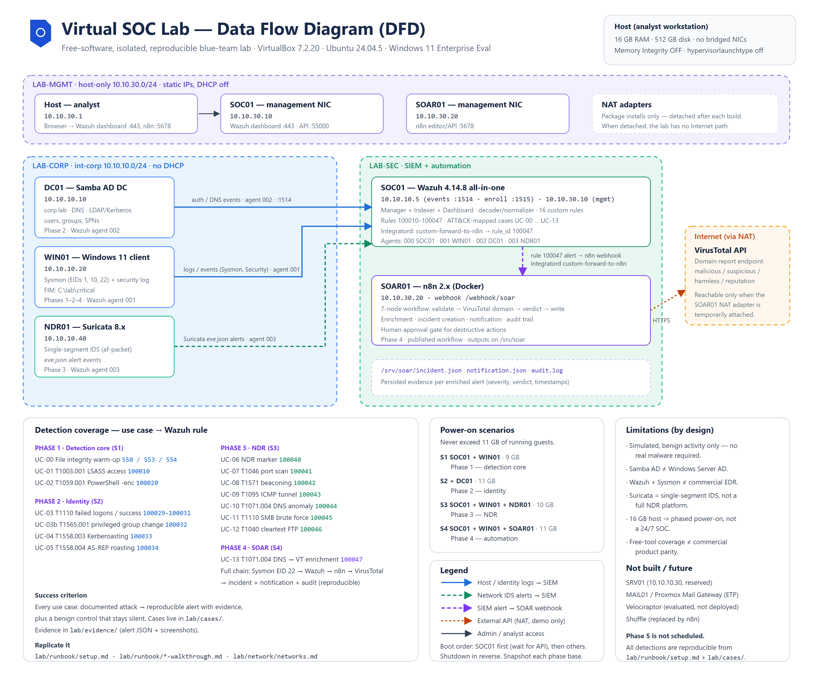

# Virtual SOC Lab

> A free, reproducible blue-team lab. Every detection is a simulated attack you can
> re-run, an alert with evidence behind it, and — for the automated case — a response
> you can audit.

This is a hands-on SOC (Security Operations Center) built entirely with free software on a
single 16 GB Windows host with VirtualBox. It emulates a small company: a Windows endpoint,
an Active Directory domain, a network sensor, a SIEM, and an automation platform. It exists
to answer one question with evidence rather than screenshots of installed tools:

**Can a documented attack produce a reproducible alert, be investigated, and trigger a
controlled automated response?**

Everything needed to rebuild it, run the exercises, and verify the results is in this
repository.

---

## The idea: detections, not dashboards

Many home labs stop at "the SIEM is installed and the dashboard loads." That is not the
success criterion here. A use case is only complete when **all** of these hold:

1. A documented, authorised, **simulated** attack runs inside the isolated lab.
2. The activity produces the expected **telemetry** in its source (Sysmon, Windows
   Security, Samba audit, Suricata).
3. The events reach the SIEM with useful fields and correct timestamps.
4. A **rule fires reproducibly** — same input, same alert.
5. The alert carries enough evidence to investigate (who, what, where, when).
6. A **benign control** — similar but legitimate activity — stays silent.
7. Another person can repeat the whole thing from this repository.

Each use case lives in [`lab/cases/`](lab/cases/), with its hypothesis, prerequisites,
procedure, expected events, rule, evidence, false positives, and cleanup.

---

## What's inside

| Layer | Tool | Where | Phase |
|---|---|---|---|
| SIEM / host monitoring | Wazuh 4.14.8 (manager + indexer + dashboard) | SOC01 | 1–4 |
| Endpoint telemetry | Sysmon + Wazuh agent | WIN01 | 1–4 |
| Identity | Samba AD DC (`corp.lab`), DNS, LDAP/Kerberos | DC01 | 2 |
| Network detection (NDR) | Suricata 8.x IDS + Wazuh agent | NDR01 | 3 |
| Automation (SOAR) | n8n 2.x (Docker) + VirusTotal API | SOAR01 | 4 |
| Virtualisation | VirtualBox 7.2.20 on Windows | Host | 0 |

No commercial licences, no paid tiers, no real malware required.

### Architecture



Two isolated networks (plus host-only management); no bridged adapters:

| Network | Subnet | Members |
|---|---|---|
| LAB-MGMT (host-only) | `10.10.30.0/24` | Host `.1`, SOC01 `.10`, SOAR01 `.20` |
| LAB-CORP (internal) | `10.10.10.0/24` | SOC01 `.5`, WIN01 `.20`, DC01 `.10`, NDR01 `.40` |

NAT adapters are used only for package installation and are detached after each build, so
the finished lab has no Internet path. The exception is the UC-13 demo, which temporarily
re-attaches SOAR01's NAT adapter to query VirusTotal.

### Power-on scenarios

A 16 GB host cannot run every VM at once. Never exceed **11 GB** of running guests.

| Scenario | Guests | Guest RAM | Used for |
|---|---|---|---|
| **S1** | SOC01 + WIN01 | 9 GB | Phase 1 detections |
| **S2** | SOC01 + WIN01 + DC01 | 11 GB | Phase 2 identity |
| **S3** | SOC01 + WIN01 + NDR01 | 10 GB | Phase 3 NDR |
| **S4** | SOC01 + WIN01 + SOAR01 | 11 GB | Phase 4 automation |

Boot SOC01 first and wait for the API, then the others. Shut down in reverse order.
Per-VM RAM: SOC01 5 GB, WIN01 4 GB, DC01 2 GB, NDR01 1 GB, SOAR01 2 GB.

---

## Detection coverage

Custom rules are `100010`–`100047` in [`lab/soc01/local_rules.xml`](lab/soc01/local_rules.xml);
UC-00 uses built-in FIM rules. Each row links to its case note.

| Use case | Technique | Telemetry | Rule | Level | Scenario |
|---|---|---|---|---|---|
| [UC-00 File integrity](lab/cases/uc-00-fim.md) | — | Wazuh FIM | `550`/`553`/`554` (built-in) | — | S1 |
| [UC-01 LSASS access](lab/cases/uc-01-t1003-lsass.md) | T1003.001 | Sysmon EID 10 | `100010` | 12 | S1 |
| [UC-02 PowerShell -enc](lab/cases/uc-02-t1059-powershell-enc.md) | T1059.001 | Sysmon EID 1 / 4104 | `100020` | 12 | S1 |
| [UC-03 Failed logons](lab/cases/uc-03-t1110-logon-burst.md) | T1110 / T1078 | Windows Security / Samba audit | `100029`–`100031` | 3–12 | S2 |
| [UC-03b Privileged group change](lab/cases/uc-03-t1110-logon-burst.md) | T1565.001 | FIM (`sam.ldb.d`) | `100032` | 12 | S2 |
| [UC-04 Kerberoasting](lab/cases/uc-04-t1558-003-kerberoasting.md) | T1558.003 | Samba KDC audit | `100033` | 12 | S2 |
| [UC-05 AS-REP roasting](lab/cases/uc-05-t1558-004-asrep.md) | T1558.004 | Samba KDC audit | `100034` | 12 | S2 |
| [UC-06 NDR marker](lab/cases/uc-06-ndr-marker.md) | — | Suricata `eve.json` | `100040` | 8 | S3 |
| [UC-07 Port scan](lab/cases/uc-07-t1046-port-scan.md) | T1046 | Suricata | `100041` | 10 | S3 |
| [UC-08 Beaconing](lab/cases/uc-08-t1571-beaconing.md) | T1571 | Suricata | `100042` | 12 | S3 |
| [UC-09 ICMP tunnel](lab/cases/uc-09-t1095-icmp-tunnel.md) | T1095 | Suricata | `100043` | 12 | S3 |
| [UC-10 DNS anomaly](lab/cases/uc-10-t1071-004-dns-anomaly.md) | T1071.004 | Suricata | `100044` | 12 | S3 |
| [UC-11 SMB brute force](lab/cases/uc-11-t1110-smb-brute.md) | T1110 | Suricata | `100045` | 12 | S3 |
| [UC-12 Cleartext FTP](lab/cases/uc-12-t1040-cleartext-ftp.md) | T1040 | Suricata | `100046` | 10 | S3 |
| [UC-13 DNS → VirusTotal → SOAR](lab/cases/uc-13-soar-vt-enrichment.md) | T1071.004 | Sysmon EID 22 → Wazuh → n8n | `100047` | 12 | S4 |

The full incident chain for UC-13:

```
Sysmon DNS query (WIN01)
  → Wazuh rule 100047 (SOC01)
  → integratord custom-forward-to-n8n webhook
  → n8n workflow (SOAR01) → VirusTotal domain report
  → incident.json + notification.json + audit.log (/srv/soar)
```

---

## Phases

The lab was built in phases so the 16 GB host stays usable and each capability is proven
before the next is added.

| Phase | Proves | Guests | Design / plan |
|---|---|---|---|
| **0** Host prep | VirtualBox, isolated networks, no bridged NICs | — | [spec](docs/superpowers/specs/2026-10-12-virtual-soc-phase-architecture-design.md) |
| **1** Detection core | Endpoint telemetry → reproducible SIEM alerts (UC-00…UC-02) | SOC01 + WIN01 | [plan](docs/superpowers/plans/2026-10-12-phase0-1-detection-core.md) |
| **2** Identity | Domain, logon correlation, Kerberos abuse detections (UC-03…UC-05) | + DC01 | [plan](docs/superpowers/plans/2026-10-18-phase2-identity.md) |
| **3** NDR | Network IDS feeding the SIEM (UC-06…UC-12) | + NDR01 | [plan](docs/superpowers/plans/2026-10-29-phase3-ndr.md) |
| **4** Automation | SIEM alert → SOAR enrichment + audited outputs (UC-13) | + SOAR01 | [plan](docs/superpowers/plans/2026-11-14-phase4-soar.md) |

Phase 5 (email gateway, additional servers, Velociraptor) is **not scheduled**.

---

## Reproduce it

### Prerequisites

- **Host:** Windows, 16 GB RAM, 4+ cores, ~120 GB free disk, CPU virtualisation enabled.
- **VirtualBox 7.2.20** + Extension Pack (installed elevated). Memory Integrity off and
  `bcdedit /set hypervisorlaunchtype off` — see `lab/runbook/setup.md` §0.
- **ISOs:** Ubuntu 24.04.5 live-server (amd64) and Windows 11 Enterprise Evaluation (x64),
  placed in `C:\iso\` (the runbook uses that convention).
- **PuTTY** (`plink`/`pscp`) — Windows `ssh.exe` is too old for Ubuntu 24.04's KEX.
- A free **VirusTotal API key** for the UC-13 demo.

### Quickstart

1. Read [`lab/network/networks.md`](lab/network/networks.md) and
   [`lab/runbook/setup.md`](lab/runbook/setup.md).
2. Do host prep (`setup.md` §0).
3. Create your local credentials file:
   copy [`lab/runbook/.local-credentials.example.md`](lab/runbook/.local-credentials.example.md)
   to `lab/runbook/.local-credentials.md` and fill it in (gitignored — never commit it).
4. Build Phase 1 (`setup.md` §1–2), snapshot `base-phase1`.
5. Power on **S1**, run UC-00 and UC-01 from [`lab/cases/`](lab/cases/), and confirm the
   expected rules in Wazuh Discover. Record the result in
   [`lab/cases/exercise-log.md`](lab/cases/exercise-log.md).
6. Continue with Phases 2–4 (`setup.md` §3–5) and run the matching use cases on S2–S4.
7. Follow the full step-by-step checklist in
   [`lab/runbook/replicate.md`](lab/runbook/replicate.md).

Each case note contains the attack procedure, expected events, expected rule, benign
control, and cleanup. Per-VM runbooks and teaching walkthroughs are in
[`lab/runbook/`](lab/runbook/).

---

## Evidence

Results are exported, not just described:

- [`lab/evidence/phase4-alerts.json`](lab/evidence/phase4-alerts.json) — UC-13 Wazuh alerts
- [`lab/evidence/phase4-incident.json`](lab/evidence/phase4-incident.json) — SOAR incident output
- [`lab/evidence/`](lab/evidence/) — phase 2/3 captures and UC-01…UC-12 alert screenshots
- [`lab/cases/exercise-log.md`](lab/cases/exercise-log.md) — expected vs observed for every run

How to export, and what must never be committed, is in
[`lab/evidence/README.md`](lab/evidence/README.md).

---

## Repository layout

```
.
├── docs/
│   ├── DFD.PNG / dfd.svg              # current data-flow diagram (+ editable source)
│   ├── initial_info.md                # original project brief
│   └── superpowers/
│       ├── specs/                     # architecture + per-phase design specs
│       └── plans/                     # per-phase implementation plans
└── lab/
    ├── README.md                      # power-on matrix, limits, current state
    ├── network/networks.md            # subnets, addressing, guest NICs
    ├── runbook/
    │   ├── setup.md                   # rebuild from scratch, every command
    │   ├── replicate.md               # replication + test checklist
    │   ├── *-walkthrough.md           # teaching walkthroughs per VM
    │   └── *.md                       # terse per-VM runbooks
    ├── cases/                         # UC-00…UC-13 + how-to + lessons + exercise log
    ├── evidence/                      # alert JSON exports and screenshots
    ├── soc01/                         # local rules, Wazuh→n8n integration, FTP test server
    ├── win01/                         # Sysmon config, agent additions
    ├── dc01/                          # Samba smb.conf, rsyslog, agent additions
    ├── ndr01/                         # Suricata config + rules + test scripts
    └── soar01/                        # n8n workflow (importable JSON) + notes
```

---

## Limitations and honest scope

This is a teaching/portfolio lab, not a production SOC:

- Activity is **simulated and benign**; no real malware is required.
- **Samba AD** is not Windows Server AD — some Microsoft-specific behaviour differs.
- **Wazuh + Sysmon** is strong host telemetry, not a commercial EDR.
- **Suricata** here is a single-segment IDS, not a full NDR platform.
- The 16 GB host forces **phased power-on**; the lab is not a 24/7 SOC.
- Free-tool coverage is **not commercial-product parity**.

These are documented explicitly rather than hidden; see [`lab/README.md`](lab/README.md).

---

## Safety and responsible use

- All lab traffic stays on **host-only/internal** VirtualBox networks. No bridged adapters.
- Only **test accounts and test assets**; credentials are lab-only and never committed
  (`.local-credentials.md` is gitignored).
- Automated response is limited to lab assets, logged, and requires **human approval** for
  destructive or high-impact actions.
- Never expose the lab to the Internet. NAT is attached only for installs (and temporarily
  for the VirusTotal demo).
- Use this material only against systems you own or are explicitly authorised to test.

---

## Status

**Phase 4 complete.** UC-13 passes end to end twice (alert → n8n → VirusTotal →
incident/notification/audit), with a benign control that stays silent. All prior use cases
(UC-00…UC-12) pass with recorded evidence. Phase 5 is not scheduled.
